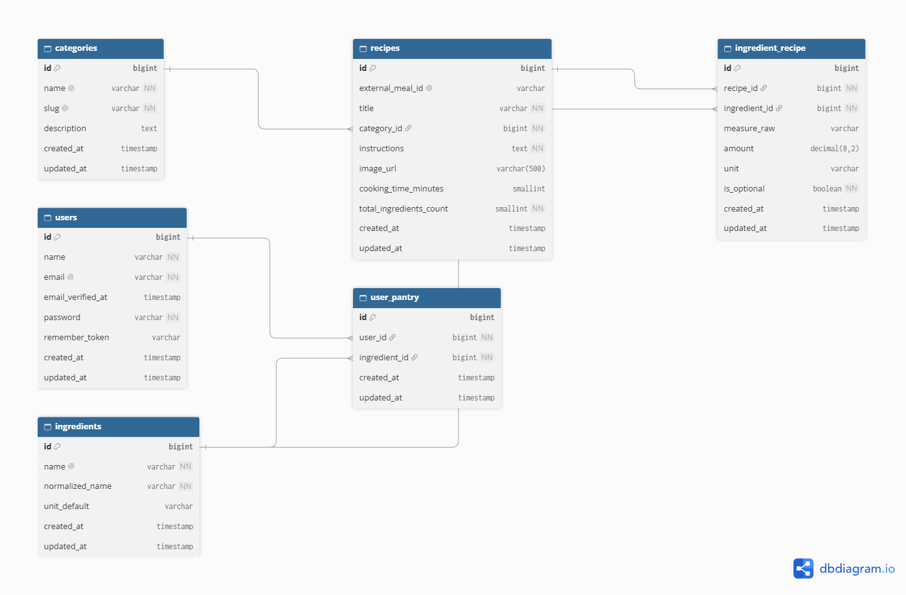

# База даних



Вихідний код діаграми для редагування: [`diagrams/er-diagram.dbml`](diagrams/er-diagram.dbml) (формат DBML, відкривається на [dbdiagram.io](https://dbdiagram.io/d)). Картинку `er-diagram.png` експортовано звідти: *Export → Export to PNG*.

## Таблиці

| Таблиця | Призначення | Ключові обмеження та індекси |
| :--- | :--- | :--- |
| `users` | користувачі системи | `email` unique |
| `categories` | категорії страв (назви збігаються з `strCategory` TheMealDB) | `name` unique, `slug` unique |
| `ingredients` | довідник унікальних інгредієнтів | `name` unique, індекс `normalized_name` |
| `recipes` | каталог страв | `external_meal_id` unique, FK `category_id`, індекс `total_ingredients_count` |
| `ingredient_recipe` | зв'язок M:N рецепт ↔ інгредієнт з полями `measure_raw`, `amount`, `unit`, `is_optional` | unique `(recipe_id, ingredient_id)`, індекс `ingredient_id` |
| `user_pantry` | інгредієнти в холодильнику користувача | unique `(user_id, ingredient_id)` |

Правила видалення: видалення рецепта каскадно очищає `ingredient_recipe`; категорію та інгредієнт, на які є посилання, видалити не можна (`restrictOnDelete`).

## Нормалізація інгредієнтів

`normalized_name` це назва в нижньому регістрі без зайвих пробілів (`Ingredient::normalize()`), вона заповнюється автоматично при збереженні моделі. Імпортер шукає інгредієнт саме за нею, тому «Garlic», «garlic» і « GARLIC » потрапляють в один запис.

`total_ingredients_count` оновлюється методом `Recipe::refreshIngredientsCount()` після прив'язки інгредієнтів. Саме це поле використовує алгоритм підбору страв для розрахунку `missing_count` і `coverage`.

## Імпорт з TheMealDB

```bash
php artisan recipes:import-external --category=Seafood   # одна категорія
php artisan recipes:import-external --limit=5            # усі категорії, по 5 страв
php artisan recipes:import-external --with-catalog       # + довідник усіх інгредієнтів
```

Імпорт ідемпотентний: повторний запуск оновлює страви, а не дублює їх. Кожна страва зберігається в окремій транзакції, помилка однієї не зупиняє решту (деталі в `storage/logs/laravel.log`).

Текстова міра (`strMeasureN`) розбирається на кількість і одиницю класом `App\Support\MeasureParser`: `"3/4 cup"` дає `0.75 / cup`. Міри без числа (`"Pinch"`, `"to taste"`) мають `amount = NULL`, а вихідний текст лишається в `measure_raw`.

## Наповнення

```bash
php artisan migrate:fresh --seed
```

Створює категорії, 20 базових інгредієнтів, 5 демо-рецептів, тестового користувача `test@example.com` (пароль `password`) із демо-холодильником.
